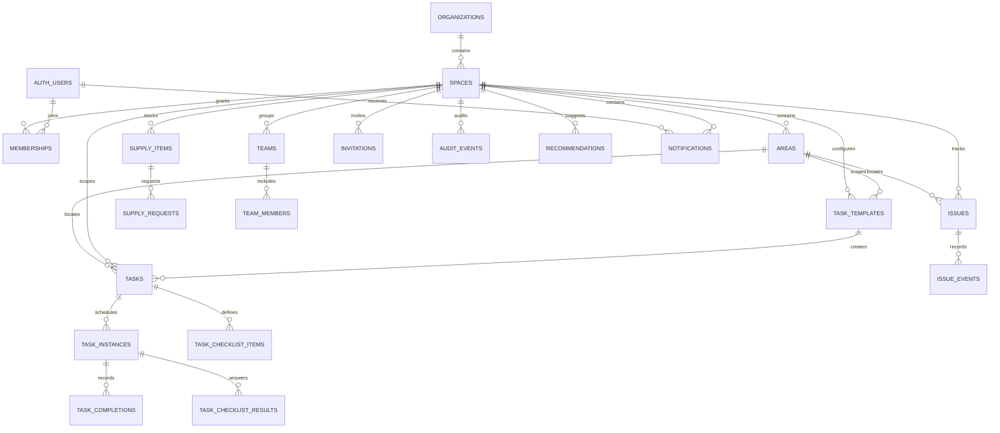

# Core entity relationship diagram

This is a conceptual diagram of the current core schema; Level 10 entities are not present yet. Exact columns, nullability, delete actions, and RLS policies are defined in ordered migrations under `supabase/migrations/`.
