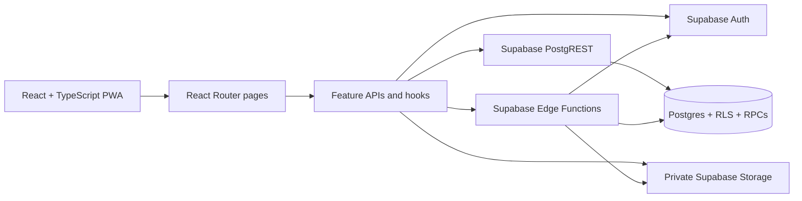

# Neatly architecture

The app keeps domain UI under `src/features`, shared UI under `src/components`, and database contracts under `src/types`. The authenticated application is bootstrapped separately from `/demo`; the demo route uses tab-scoped `sessionStorage` only and does not initialize Supabase at runtime. Database authorization is intended to be enforced by RLS and checked RPCs, not by route visibility alone.

## Trust boundaries

- `VITE_SUPABASE_URL` and `VITE_SUPABASE_ANON_KEY` are public browser configuration. The anon key is not a secret and must be constrained by RLS.
- `SUPABASE_SERVICE_ROLE_KEY` must only be configured as a Supabase Edge Function secret; never expose it through a `VITE_` variable or static host.
- The account deletion function authenticates the caller, runs the caller-scoped ownership preparation RPC, and uses the service role only for Auth admin deletion and private user-evidence cleanup.
- Storage buckets containing user evidence are private. The application should read them using signed URLs with database-derived authorization.
- Netlify response headers provide the static-host security policy. For another host, port the policy in `netlify.toml` and validate it against the deployment's Supabase hostname and camera workflow.

## Offline and error behavior

The service worker precaches the app shell and applies a time-limited NetworkFirst cache to Supabase GET requests. It does not queue task mutations, resolve sync conflicts, or guarantee current data. A reload may show cached responses while offline. Device-local crash diagnostics contain only error class and time; there is no third-party or central error-monitoring service configured.
